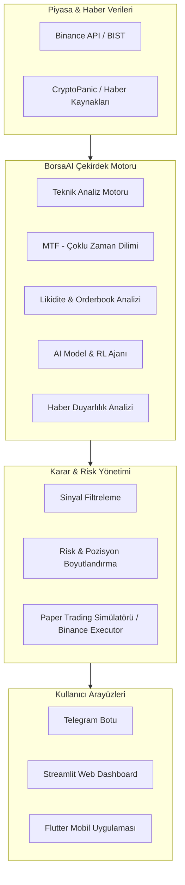

# 📈 BorsaAI - Yapay Zeka Destekli Borsa & Kripto Ticaret Platformu

[](https://www.python.org/)
[](https://fastapi.tiangolo.com/)
[](https://streamlit.io/)
[](https://flutter.dev/)
[](https://www.docker.com/)
[](https://telegram.org/)
[](LICENSE)

**BorsaAI**, finansal piyasalarda (BIST ve Kripto/Binance) veri analizi, makine öğrenimi modelleri, çok zaman dilimli teknik göstergeler ve haber duyarlılığı analizini bir araya getiren kapsamlı bir **otonom piyasa analiz ve işlem asistanıdır**.

Sistem, anlık piyasa verilerini izler, derinlemesine sinyal üretir, Telegram botu üzerinden alarmlar iletir, etkileşimli Streamlit kontrol paneli sunar ve Flutter tabanlı bir mobil yardımcı uygulama içerir.

---

## 🌟 Öne Çıkan Özellikler

- 🤖 **Yapay Zeka & ML Modelleri:** Fiyat hareketlerini ve trend dönüşümlerini tahminleyen makine öğrenimi ve pekiştirmeli öğrenme (Reinforcement Learning - RL) ajanları.
- ⏱️ **Çok Zaman Dilimli Motor (Multi-Timeframe Engine):** 5m, 15m, 1h, 4h ve 1d grafiklerini eş zamanlı inceleyerek yüksek olasılıklı trend onayları.
- 💧 **Likidite & Fiyat Hareketi (Price Action):** Destek/direnç kırılımları, likidite havuzları, order block ve imbalance tespitleri.
- 📰 **Haber & Sosyal Duyarlılık:** Finansal haberleri (CryptoPanic vb.) NLP algoritmalarıyla tarayarak piyasa duyarlılık (sentiment) skoru üretimi.
- 🛡️ **Gelişmiş Risk Yönetimi:** Dinamik Stop-Loss, Take-Profit (TP1, TP2) hesaplamaları ve sermaye risk kuralı (%2 kuralı).
- 📝 **Paper Trading & Canlı Binance Entegrasyonu:** Gerçek bakiyeyi riske atmadan stratejileri test edebilmek için gerçekçi sanal borsa simülatörü ve canlı emir iletim modülü.
- 📱 **Telegram Botu & Canlı Bildirimler:** Butonlu (inline keyboard) interaktif komut yönetimi, anlık pozisyon açma/kapama bildirimleri.
- 📊 **Streamlit Dashboard & Flutter App:** Hem web tarayıcısından hem de mobil cihazlardan izlenebilen zengin görselleştirme paneli.

---

## 🏗️ Sistem Mimarisi



---

## 📂 Proje Yapısı

```
borsaai/
├── modules/
│   ├── ai_model.py              # ML/AI fiyat ve sinyal tahmin modeli
│   ├── rl_agent.py              # Pekiştirmeli öğrenme (Reinforcement Learning) ajanı
│   ├── mtf_engine.py            # Çok zaman dilimli (Multi-Timeframe) analiz
│   ├── teknik.py                # RSI, MACD, EMA, ATR ve teknik indikatörler
│   ├── liquidity.py             # Likidite seviyeleri ve emir blokları
│   ├── news.py                  # Haber duyarlılık (sentiment) analizi
│   ├── paper_trader.py          # Sanal işlem ve simülasyon motoru
│   ├── binance_trader.py        # Canlı Binance Futures/Spot işlem motoru
│   └── database.py              # Pozisyon ve geçmiş kayıt veritabanı
├── flutter_app/                 # Flutter mobil istemci uygulaması
├── dashboard.py                 # Streamlit web arayüzü
├── telegram_bot.py              # Telegram bildirim ve kontrol botu
├── backtest.py                  # Geçmiş veri performans ve strateji testi
├── api.py                       # REST API sunucusu
├── docker-compose.yml           # Docker konteyner yapılandırması
├── Dockerfile                   # Docker imaj tanımı
├── requirements.txt             # Python bağımlılıkları
├── .env.example                 # Örnek ortam değişkenleri şablonu
└── main.py                      # Ana orkestrasyon ve döngü servisi
```

---

## 🚀 Hızlı Başlangıç

### 1. Gereksinimler
* Python 3.10+
* Git
* (Opsiyonel) Docker & Docker Compose
* (Opsiyonel) Flutter SDK (Mobil arayüz için)

### 2. Kurulum
```bash
# Depoyu klonlayın
git clone https://github.com/siladgn/borsaai.git
cd borsaai

# Sanal ortam oluşturup aktif edin
python -m venv venv
# Windows için:
venv\Scripts\activate
# Linux/macOS için:
source venv/bin/activate

# Bağımlılıkları yükleyin
pip install -r requirements.txt
```

### 3. Ortam Değişkenlerini Yapılandırma
`.env.example` dosyasını `.env` olarak kopyalayın ve bilgilerinizi girin:
```bash
cp .env.example .env
```

```ini
# Telegram Bot Bilgileri
TELEGRAM_TOKEN=bot_tokeniniz
TELEGRAM_CHAT_ID=chat_id_numaraniz

# Haber API (Opsiyonel)
CRYPTOPANIC_API_KEY=api_key

# Binance (İsteğe bağlı - Gerçek işlemler için)
BINANCE_API_KEY=binance_api_key
BINANCE_SECRET_KEY=binance_secret_key

# Risk & İşlem Modu
PAPER_TRADING=True # Sanal bakiye ile test etmek için True
TOPLAM_BAKIYE=1000
ISLEM_BASI_RISK=0.02
```

### 4. Çalıştırma

* **Ana Motoru Başlatma:**
  ```bash
  python main.py
  ```

* **Streamlit Web Panelini Başlatma:**
  ```bash
  streamlit run dashboard.py
  ```

* **Docker ile Çalıştırma:**
  ```bash
  docker-compose up -d --build
  ```

* **Flutter Mobil Uygulamasını Başlatma:**
  ```bash
  cd flutter_app
  flutter run
  ```

---

## 🧪 Backtesting & Strateji Optimizasyonu

Geçmiş veriler üzerinde strateji performansını test etmek için:
```bash
python backtest.py
```
Toplam kâr/zarar, maksimum düşüş (drawdown), Sharpe oranı ve işlem başarı yüzdesi konsola ve rapor dosyalarına aktarılır.

---

## ⚠️ Yasal Uyarı (Disclaimer)

Bu yazılım yalnızca eğitim ve araştırma amaçlı geliştirilmiştir. Kesinlikle bir **yatırım tavsiyesi değildir**. Finansal piyasalarda işlem yapmak yüksek derecede risk içerir; algoritmik modeller geçmiş verilerden hareketle tahminde bulunur ve gelecekteki getiriyi garanti etmez. Gerçek sermaye ile yapılacak tüm işlemler kullanıcının kendi sorumluluğundadır.

---

## 📄 Lisans

Bu proje [MIT Lisansı](LICENSE) kapsamında lisanslanmıştır.
